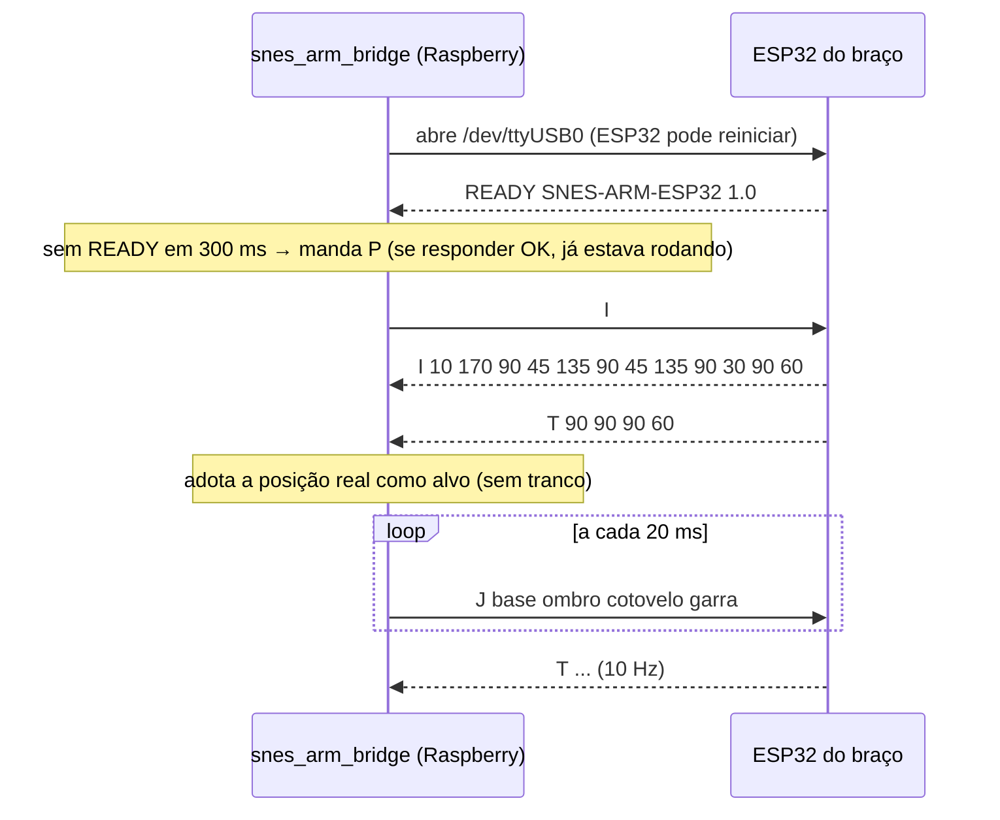

# Protocolo Raspberry Pi ↔ braço

Texto ASCII, uma linha por quadro terminada em `\n` (o firmware também aceita `\r\n`),
campos separados por espaço. Serial USB **115200 8N1**. O mesmo protocolo roda por TCP
no simulador (`braco/simulador/arm_sim.py`, porta 7878).

Evolução do protocolo da wiki "Braço Robótico ‐ Semana 31\08‐08\09". O que mudou e por quê:

| Mudança | Motivo |
|---|---|
| `J` não recebe mais `OK` | A 50 Hz isso daria 50 respostas por segundo. A repetição do `J` já serve de heartbeat |
| `T` sai sempre a 10 Hz, sem pedido | A bridge usa a telemetria para saber onde o braço está ao conectar, sem tranco |
| Novo `I` (limites) | Os limites ficam só no `ArmConfig.h`. A bridge os adota e não acumula alvo fora do curso |
| Novo `READY` no boot | Abrir a serial reinicia o ESP32 DevKit. A bridge espera o boot terminar |
| Linhas `#` nos dois sentidos | Comentários: o firmware ignora, o simulador mostra (página ativa, home) |

## Raspberry → braço

| Quadro | Significado | Resposta |
|---|---|---|
| `J <base> <ombro> <cotovelo> <garra>` | Ângulos-alvo em graus. Vem a 50 Hz, mesmo sem mudança | nenhuma (`ERR` se malformado) |
| `G <0-100>` | Abertura da garra em % (0 = fechada) | `OK` |
| `H` | Volta para home a 60°/s. Não é cancelado pelo watchdog | `OK` |
| `S` | Congela os servos onde estão. O próximo `J` retoma | `OK` |
| `P` | Ping | `OK` |
| `I` | Pede os limites de curso | `I <min> <max> <home>` × 4 |
| `# texto` | Comentário | nenhuma |

Exemplo: `J 90 45 120 60`

## Braço → Raspberry

| Quadro | Significado |
|---|---|
| `READY <versão>` | Firmware acabou de iniciar (ex.: `READY SNES-ARM-ESP32 1.0`) |
| `OK` | Comando aceito |
| `ERR <motivo>` | Quadro inválido |
| `T <base> <ombro> <cotovelo> <garra>` | Ângulos realmente aplicados (com rampa), a 10 Hz |
| `I <min> <max> <home> ×4` | Limites, na ordem base, ombro, cotovelo, garra |
| `# texto` | Log para humanos |

## Sequência de conexão (bridge)

Enquanto essa sequência não termina, a bridge **ignora os botões**. Apertar algo com o braço
desligado não pode virar um salto quando ele ligar.

## Segurança

- **Watchdog no firmware:** 300 ms sem `J` e os servos congelam (`# WATCHDOG` no log).
  Cabo arrancado, bridge travada ou `kill -9` não deixam o braço andando sozinho.
- **Limites no firmware:** todo alvo é saturado em `min..max` de cada junta (`ArmConfig.h`).
  Um bug na Raspberry não consegue mandar o servo bater na estrutura.
- **Rampa no firmware:** no máximo 180°/s por junta. Um `J` com salto grande vira um movimento rápido, mas contínuo.
- **Ao sair**, a bridge manda `S`.
