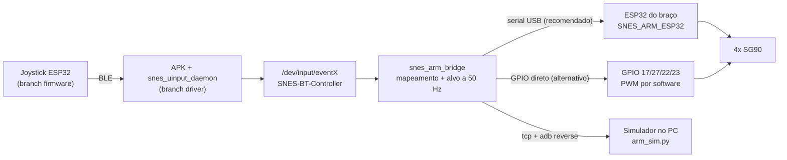

# Integração Raspberry Pi ↔ braço robótico

Equipe Robô: comunicação Raspberry Pi × braço (Caio, William). Branch `integracao-braco`.

> **Só quer fazer funcionar?** Veja o [TUTORIAL.md](TUTORIAL.md) (o que precisa, instalar, usar, problemas comuns).

O joystick já chega ao Android como um gamepad (`/dev/input/eventX` "SNES-BT-Controller",
criado pelo `snes_uinput_daemon` da branch `driver`). Esta parte **lê esse gamepad, traduz os
botões em movimento das 4 juntas e comanda o braço**.



A bridge não sabe de onde o gamepad vem: BLE, cabo, um módulo de kernel no futuro, ou o
controle falso `snes_fake_pad`. O braço também não sabe que existe um joystick. Esse corte
segue a regra da wiki: cada parte pode ser testada sem as outras.

## Qual caminho usar: ESP32 ou direto pela Raspberry?

**Recomendado: Raspberry → ESP32 (USB serial) → servos.** Os dois foram implementados e
testados. Escolhe-se com `--backend`.

| | **ESP32 via USB** (`--backend serial`) | **Direto na Raspberry** (`--backend gpio`) |
|---|---|---|
| PWM dos servos | Hardware (LEDC), sem jitter | Software (thread SCHED_FIFO). Jitter medido de 4–10 µs em média, pior caso 28 µs |
| Precisa mudar o AOSP/boot? | Não. `cp210x` e `cdc-acm` já estão no kernel | Não. Usa `/dev/gpiochip0`, sem `config.txt` |
| Se a Raspberry travar | Watchdog do ESP32 congela o braço em 300 ms | O processo morre e os servos ficam sem pulso (soltos) |
| Limites e rampa | No firmware: um bug na Pi não força o servo | Só na bridge |
| Hardware extra | Um ESP32 com CP2102 ou USB nativo | Nenhum (fonte 5 V para os servos, nos dois casos) |
| Combina com o plano da equipe | Sim (wiki do William: ESP32 com servos nos GPIO 25/26/27) | Serve de plano B se faltar ESP32 |

Por que não as outras opções:
- **PWM de hardware da Pi:** são só 2 canais para 4 servos, e eles estão desligados no device tree do GloDroid.
- **Placa PCA9685 (I2C):** o I2C1 também está desligado, o kernel não tem o driver `pwm-pca9685` e exige hardware extra.
- **UART nos pinos 14/15:** o `ttyS0` é o **console do Android**, com um shell rodando nele.
- **ESP32 do joystick mexendo o braço sozinho:** tiraria a Raspberry/AOSP do caminho, que é o objetivo do projeto.

## Mapeamento do controle

O controle atual tem só A, B, X, Y, SELECT e START, sem D-pad. As juntas ficam em duas
**páginas**, alternadas pelo START:

| Botão | Página 1: COTOVELO/GARRA (inicial) | Página 2: BASE/OMBRO |
|---|---|---|
| B | cotovelo sobe | ombro sobe |
| Y | cotovelo desce | ombro desce |
| A | abre a garra | base gira (+) |
| X | fecha a garra | base gira (−) |
| START curto | troca de página | troca de página |
| START segurado 1,5 s | volta para home | volta para home |
| D-pad (se adicionarem) | ←/→ base, ↑/↓ ombro | ←/→ base, ↑/↓ ombro |
| SELECT | ignorado: o firmware do joystick usa (curto troca BLE/fio, 5 s liga o acelerômetro) | |

- **Modo jog:** a junta anda enquanto o botão está apertado (base 60°/s, ombro e cotovelo 45°/s, garra 90°/s) e para ao soltar.
- Depois de trocar de página, um botão que continuou apertado só vale depois de ser solto.
- **Acelerômetro:** o firmware do joystick transforma a inclinação em X/B/A/Y, então ele funciona nas duas páginas.

## Estrutura

```
braco/
├── bridge/                     snes_arm_bridge (C, NDK) — roda na Raspberry
│   ├── main.c                  laço de 50 Hz
│   ├── mapping.c               botões → sentido das juntas (páginas, START)
│   ├── arm_model.c             alvo, limites, home
│   ├── input_evdev.c           lê /dev/input/eventX   (input_stdin.c: testes)
│   ├── backend_serial.c        ESP32 por /dev/ttyUSB* ou /dev/ttyACM*
│   ├── backend_gpio.c          PWM por software nos GPIOs
│   ├── backend_tcp.c           simulador
│   ├── link_text.c             protocolo de texto (READY/I/T/J)
│   ├── tools/snes_fake_pad.c   controle falso via uinput
│   ├── tests/test_logic.c      testes do mapeamento e do modelo
│   └── build.sh                android | host | test | deploy
├── firmware_esp32/SNES_ARM_ESP32/   firmware do ESP32 do braço (Arduino)
│   ├── ArmConfig.h             pinos, limites, pulsos ← calibrar aqui
│   └── diagram.json            circuito para o Wokwi
├── firmware_esp32/host_test/   roda o firmware no computador (Arduino.h simulado)
├── simulador/                  arm_sim.py + painel.html (Python 3, sem dependências)
├── testes/roteiro_basico.txt   roteiro para o snes_fake_pad
├── aosp/                       opcional: iniciar a bridge no boot (build do AOSP)
└── PROTOCOLO.md                protocolo Pi ↔ braço
```

## Ligações

> ⚠️ **Os servos nunca são alimentados pela Raspberry nem pelo 3,3 V do ESP32.** Quatro SG90
> travados puxam mais de 1 A e derrubam a placa. Use uma **fonte 5 V externa de pelo menos 2 A**,
> com **GND comum**.

### Caminho recomendado: ESP32

| Servo (MeArm) | Sinal (laranja) | V+ (vermelho) | GND (marrom) |
|---|---|---|---|
| Base | ESP32 GPIO25 | fonte 5 V | GND da fonte + GND do ESP32 |
| Ombro | ESP32 GPIO26 | fonte 5 V | idem |
| Cotovelo | ESP32 GPIO27 | fonte 5 V | idem |
| Garra | ESP32 **GPIO13** | fonte 5 V | idem |

ESP32 ↔ Raspberry: cabo USB numa das portas USB-A da Pi. A placa aparece como `/dev/ttyUSB0`
(CP2102) ou `/dev/ttyACM0` (USB nativo).

> A wiki do William usa o GPIO12 para a garra. Troquei para o **GPIO13** porque o 12 é pino de
> *strapping* do ESP32: nível alto no boot muda a tensão da flash e a placa pode não iniciar.
> Se quiserem manter o 12, basta mudar `ArmConfig.h`.

> ⚠️ **CH340 não funciona:** o kernel do GloDroid não tem o driver `ch341`. Se o ESP32 do braço
> tiver chip CH340 (quadradinho perto do USB, escrito "CH340"), troque de placa ou use o
> fragmento de kernel em `aosp/`.

### Caminho alternativo: direto na Raspberry

| Servo | GPIO (BCM) | Pino físico |
|---|---|---|
| Base | GPIO17 | 11 |
| Ombro | GPIO27 | 13 |
| Cotovelo | GPIO22 | 15 |
| Garra | GPIO23 | 16 |
| GND dos servos + GND da fonte | GND | 14 (ou 9) |

O sinal de 3,3 V da Pi aciona o SG90 normalmente. Outros pinos podem ser usados com `--pins`.

## Como rodar

Pré-requisito: o NDK (a mesma versão da wiki do driver, `27.0.12077973`) e `adb root`
funcionando (build `userdebug`).

```bash
cd braco/bridge
./build.sh test      # testes de lógica no computador
./build.sh deploy    # compila ARM64 e envia snes_arm_bridge + snes_fake_pad para /data/local/tmp
```

### Com o joystick e o ESP32 do braço

1. Suba a cadeia do joystick (wiki "Comandos para executar a aplicação ‐ Driver"): `snes_uinput_daemon` e o APK.
2. Grave o firmware `firmware_esp32/SNES_ARM_ESP32` no ESP32 do braço (Arduino IDE, placa "ESP32 Dev Module", core 2.x ou 3.x).
3. Ligue o ESP32 na USB da Raspberry e rode:

```bash
adb shell /data/local/tmp/snes_arm_bridge
```

O padrão é `--backend serial --device auto`. Mais opções: `--help`.

### Sem joystick (controle falso)

```bash
adb push braco/testes/roteiro_basico.txt /data/local/tmp/
adb shell "cd /data/local/tmp && (./snes_fake_pad < roteiro_basico.txt &) ; ./snes_arm_bridge"
```

O `snes_fake_pad` cria um gamepad com o mesmo nome e os mesmos botões do daemon real. Ele
também aceita comandos digitados: `press B`, `hold A 500`, `tap START`, `hat x -1` ou `state 0xFEFF`.

### Sem braço (simulador)

No computador:

```bash
python3 braco/simulador/arm_sim.py
```

Abra http://127.0.0.1:8787. Em outro terminal:

```bash
adb reverse tcp:7878 tcp:7878
```

```bash
adb shell /data/local/tmp/snes_arm_bridge --backend tcp
```

O simulador imita o firmware: limites, rampa, watchdog, READY/I/T. O painel mostra a vista
lateral e a de cima do MeArm, a garra, a página ativa e os eventos.

Sem Raspberry, a bridge também roda no próprio computador. Ela usa `./build.sh host` e a
entrada pelo stdin:

```bash
python3 braco/simulador/arm_sim.py --pty
```

O comando acima mostra o caminho da serial falsa (`/dev/ttysNNN`). Use esse caminho em:

```bash
(echo "down B"; sleep 1; echo "up B") | braco/bridge/out/host/snes_arm_bridge --input stdin --backend serial --device /dev/ttysNNN
```

### Direto nos GPIOs da Raspberry

```bash
adb shell /data/local/tmp/snes_arm_bridge --backend gpio --stats
```

O `--stats` imprime a cada 5 s o jitter medido da borda de descida dos pulsos.

### Firmware sem hardware (no computador)

```bash
braco/firmware_esp32/host_test/run.sh
```

Compila o firmware com um `Arduino.h` simulado: a Serial vira o terminal, então dá para digitar
`J 90 120 60 80`, `H`, `I` e outros comandos. Em roteiro, `@500` espera 500 ms. Ao sair, ele
imprime o pulso de cada servo.

### Firmware sem hardware (Wokwi)

Em wokwi.com, crie um projeto ESP32 e cole `SNES_ARM_ESP32.ino`, `ArmConfig.h`,
`ServoJoint.h`, `ServoJoint.cpp` e o `diagram.json` (4 servos já ligados). No Monitor Serial, digite
`J 90 120 60 80`, `H`, `I` e assim por diante. Também dá para usar o Wokwi para VS Code, com o `wokwi.toml`.

## Calibração (com o braço montado)

Os limites de fábrica são conservadores (base 10–170°, ombro e cotovelo 45–135°, garra 30–90°)
e **precisam ser medidos** no braço real. Se um servo forçar contra o acrílico, ele esquenta e queima.

1. Grave o firmware e abra o Monitor Serial (115200, "Nova linha"). Os servos vão para home.
2. Para cada junta, mude só o ângulo dela em passos de 5°, por exemplo `J 90 90 90 60` → `J 90 90 95 60`
   → `J 90 90 100 60`. Quando a peça encostar ou o servo zumbir, volte 5°: esse é o limite.
3. Anote `min`/`max`/`home` em `ArmConfig.h`. Se a junta andar ao contrário do nome do botão, use `inverted = true`.
4. Os mesmos números devem ir para `bridge/arm_model.c`, usado só no modo `gpio`, e para `JOINTS` do
   simulador. No modo `serial`, a bridge pega os limites do firmware sozinha pelo comando `I`.

## O que foi testado (2026-10-21)

| Teste | Onde | Resultado |
|---|---|---|
| Lógica de mapeamento e modelo (9 testes) | Mac | ✅ |
| Bridge + controle falso (uinput/evdev) + simulador via `adb reverse` | Raspberry real | ✅ Páginas, D-pad, home e perda do controle |
| Protocolo pela serial (pty) com handshake READY/P/I/T | Mac | ✅ |
| Watchdog: `kill -9` na bridge com o braço em movimento | Mac | ✅ Congelou em ~300 ms |
| Sincronização ao conectar (adota a posição real) | Raspberry e Mac | ✅ |
| PWM por software nos GPIO 17/27/22/23 | Raspberry real | ✅ Jitter médio de 4–10 µs, pior 28 µs, também com a CPU carregada. Medido por software: confirmar com osciloscópio |
| Firmware do ESP32 compilado e executado no computador (`firmware_esp32/host_test`, Arduino.h simulado) | Mac | ✅ Sem warnings. P/I/G/H/ERR, watchdog de 300 ms, rampa e pulsos (170° = 2294 µs, 90° = 1450 µs) |
| Firmware no ESP32 de verdade (API LEDC do core 2.x/3.x) | — | ⏳ Compilar na Arduino IDE ou no Wokwi |
| Braço real | — | ⏳ Pendente: precisa da fonte 5 V e da calibração |

## Pendências e avisos para o time

- [ ] **APK × firmware novo:** o firmware da branch `firmware` agora manda um quadro de **8 bytes**
  (`SN`, versão, tipo, seq, p0, p1, CRC-8), mas o `MainActivity.java` da branch `driver` ainda
  lê **2 bytes**. Até isso ser ajustado, o estado que chega ao daemon é lixo. É da Equipe
  Joystick; a bridge não depende disso, porque lê o gamepad que o daemon criar.
- [ ] Os READMEs do firmware citam `receiver/snes_uinput_daemon.cpp` e `ProtocolFrame.java`, que não foram commitados.
- [ ] O modo **WIRED** do joystick (UART2 → RX/TX da Pi) cairia no `ttyS0`, que é o console do Android. Antes de usar, é preciso parar o console (`setprop ctl.stop console`) ou usar outra UART.
- [ ] Confirmar qual ESP32 vai no braço (CP2102 ou USB nativo) e a fonte de 5 V.
- [ ] Calibrar os limites e o sentido de cada junta.
- [ ] Iniciar a bridge no boot: ver `aosp/README.md`. Exige rebuild do AOSP, que roda no computador de build da equipe.
