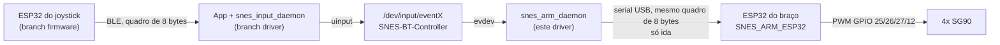

# Integração Raspberry Pi → braço robótico

Equipe Robô: comunicação Raspberry Pi × braço (Caio, William). Branch `integracao-braco`.

> **Só quer fazer funcionar?** Veja o [TUTORIAL.md](TUTORIAL.md).

O driver do Raphael (`snes_input_daemon`, branch `driver`) publica o joystick como o gamepad
`SNES-BT-Controller` na camada de eventos de input do Linux/Android. **O `snes_arm_daemon` é o segundo
driver**: ele lê esses eventos, remonta os **16 bits do controle SNES** e os repassa pela **serial USB**
ao ESP32 do braço, **sem resposta**. O ESP32 aplica a tabela da wiki do William e move os servos.



## Peças

| Pasta | O que é |
|---|---|
| `daemon/` | **`snes_arm_daemon`** (C++17, NDK), no mesmo molde do `snes_input_daemon`. Também traz `frame_sniffer` (ESP32 falso numa pty) e `snes_fake_pad` (gamepad falso) |
| `firmware_esp32/SNES_ARM_ESP32/` | Firmware do ESP32 do braço, que segue a wiki e o fluxograma do William. `ArmMapping.h` (tabela) e `FrameProtocol.*` (quadro) são C++ puro, compartilhados com o daemon e os testes |
| `firmware_esp32/host_test/` | Roda o firmware no computador, com um `Arduino.h` simulado |
| `simulador/` | `arm_sim.py`: faz o papel do ESP32 (mesmo protocolo e mesma tabela) e mostra o braço num painel web |
| `scripts/` | `deploy.sh` (enviar e iniciar na placa) e `device_test.py` (teste integrado com o daemon real do Raphael) |
| `docs/` | [DECISOES.md](docs/DECISOES.md) (ADRs e divergências), [protocolo_serial.md](docs/protocolo_serial.md) e [OPERACAO.md](docs/OPERACAO.md) |
| `aosp/` + `Android.bp` | Opcional: iniciar o daemon no boot (rebuild do AOSP) |

## O que vai na serial

O **mesmo quadro de 8 bytes que o joystick manda ao Android**, com os 16 bits como payload:

```
53 4E | 01 | 01 (CONTROLLER_STATE) | seq | p0 | p1 | CRC-8/0x07
```

O daemon envia na mudança. Enquanto houver botão pressionado, reenvia a cada 100 ms. Sem nada pressionado,
não há tráfego. Se o gamepad some, manda o neutro `0xFFFF` na hora. O ESP32 zera as direções sozinho após
250 ms sem quadro. Detalhes e vetores em [docs/protocolo_serial.md](docs/protocolo_serial.md).

## Mapeamento (wiki "Braço Robótico ‐ Semana 09\09‐21\10")

| Botão | Braço |
|---|---|
| ← / → | girar a base |
| ↑ / ↓ | subir / descer o ombro |
| B / Y | subir / descer o cotovelo |
| A / X | abrir / fechar a garra |
| Select | modo acelerômetro (tratado no joystick) |
| Start | parar os movimentos (enquanto pressionado) |

O ↑↓←→ vem do **analógico** do joystick ou, no modo acelerômetro, da **inclinação** (firmware do joystick).
A cada 25 ms, cada servo anda 1° na sua direção, dentro dos limites do `ArmConfig.h`.

## Ligações (diagrama do William)

| Servo | GPIO do ESP32 do braço |
|---|---|
| Base | 25 |
| Ombro | 26 |
| Cotovelo | 27 |
| Garra | 12 |

- **V+ dos servos numa fonte 5 V externa** (3–5 A), com **GND comum** ao ESP32. Nunca alimente os servos pela Raspberry nem pelo 3,3 V do ESP32.
- O ESP32 do braço vai numa USB da Raspberry. O kernel tem `cp210x` e `cdc-acm`, mas **não tem `ch341`**: placas com **CH340 não funcionam**.
- **GPIO12** é pino de *strapping* do ESP32. Se a placa não ligar com a garra conectada, solte esse fio durante o boot.
- **Os dois ESP32 na USB:** use `snes_arm_daemon --list` e `--device usb:<porta>`, porque a ordem `ttyUSB0`/`ttyUSB1` pode trocar. O daemon nunca abre a porta errada para "testar", já que isso reiniciaria o ESP32 do joystick.

## Testes feitos (2026-11-05)

| Teste | Onde | Resultado |
|---|---|---|
| `daemon/test.sh`: quadro, vetor de contrato, decodificador com ruído aleatório, eventos → 16 bits, tabela do William, política de envio | Mac | ✅ 41 verificações |
| **Contrato com o driver do Raphael:** as 4096 combinações publicadas pelo `ControllerDevice` dele voltam iguais pelo `SnesRegister` | Mac | ✅ e uma mutação proposital é detectada |
| Testes do `snes_input_daemon` (dele) | Mac | ✅ 56 verificações |
| Firmware do braço executado no computador: mapeamento, 1°/25 ms, watchdog de 250 ms, START, CRC errado + ressincronização, pulsos | Mac | ✅ |
| Simulador com quadros (keepalive, watchdog, CRC errado) e painel | Mac | ✅ |
| `snes_arm_daemon`, `frame_sniffer`, `snes_fake_pad` compilados para arm64 (`-Werror`) | NDK 27 | ✅ |
| `scripts/device_test.py`: ipc_probe → snes_input_daemon → **snes_arm_daemon** → serial → ESP32 falso | Raspberry | ⏳ placa desconectada nesta sessão |
| Firmware num ESP32 real com os servos | — | ⏳ |
